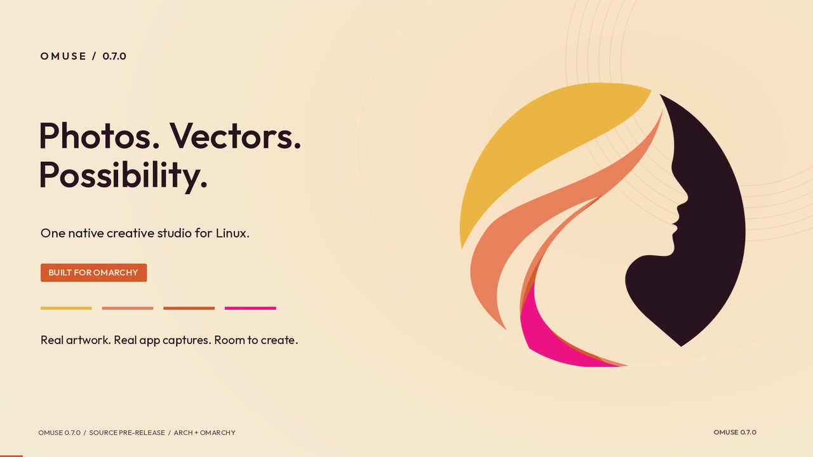
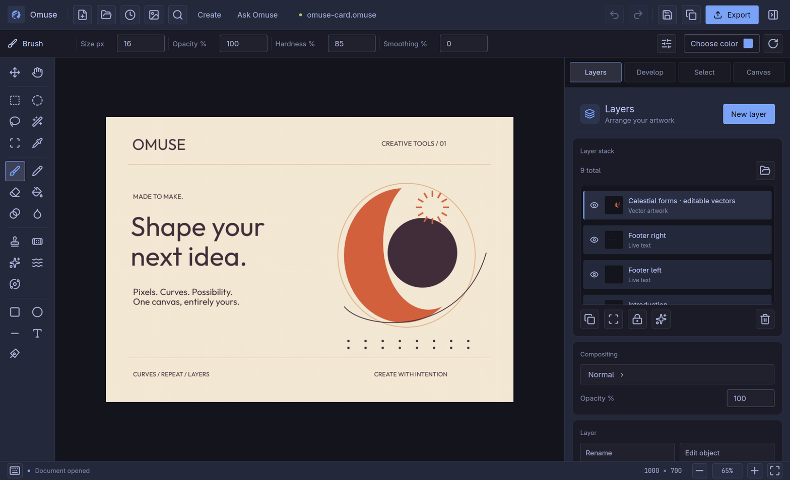
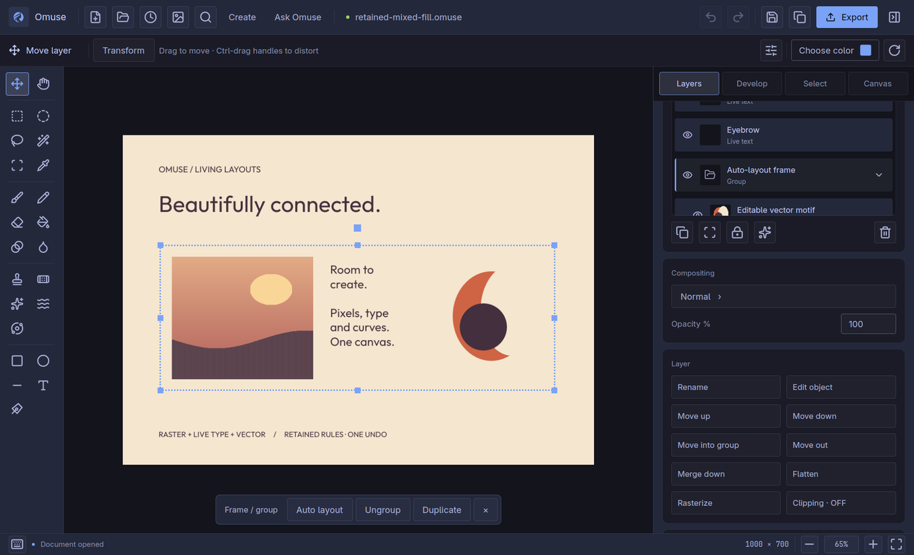
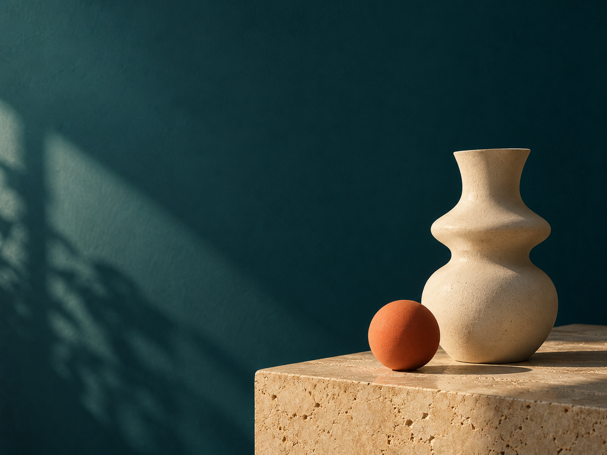
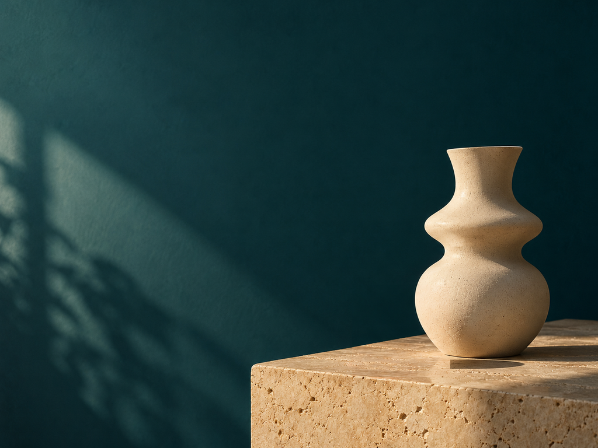
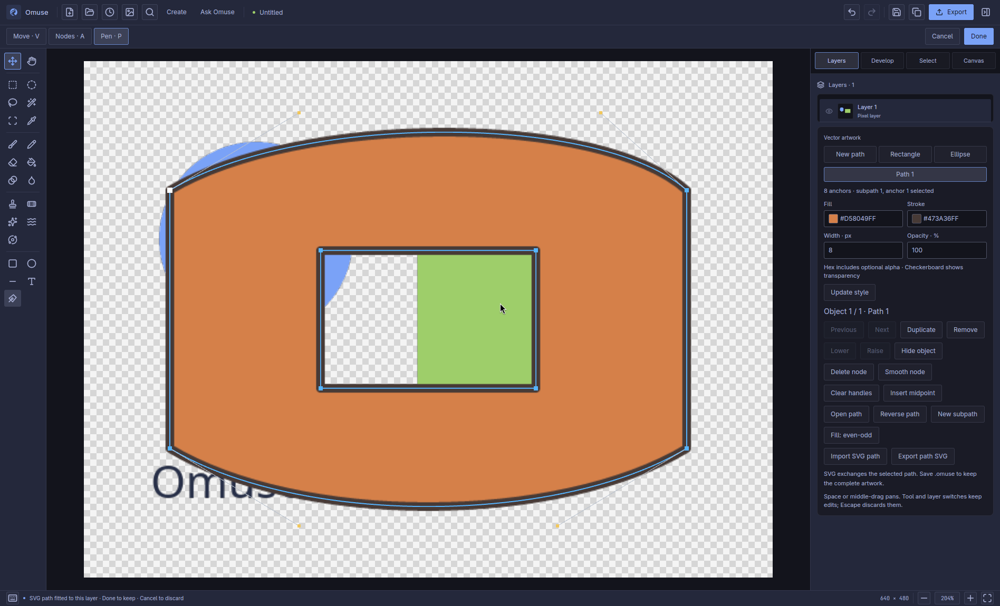
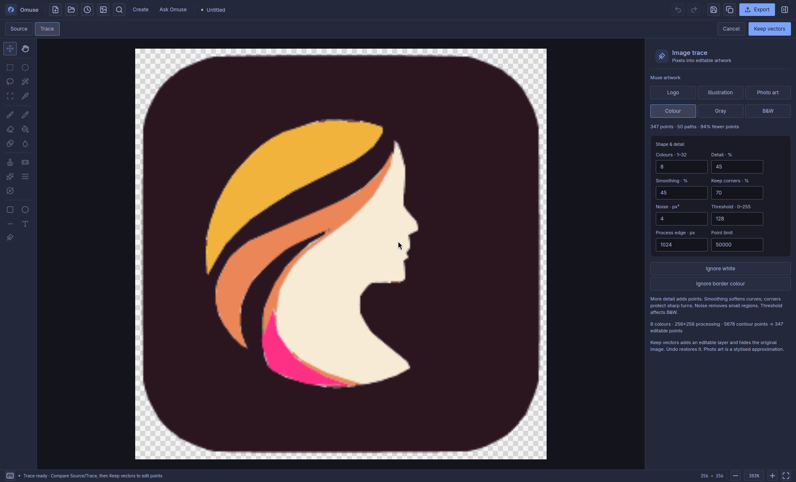
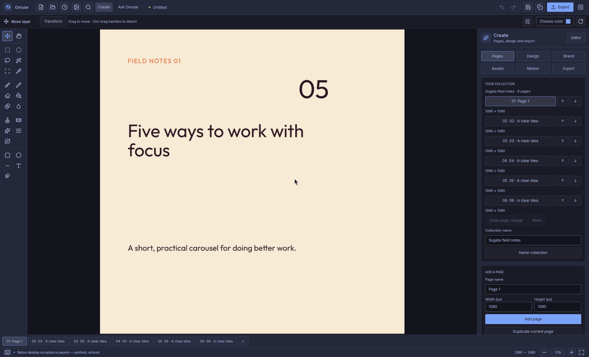
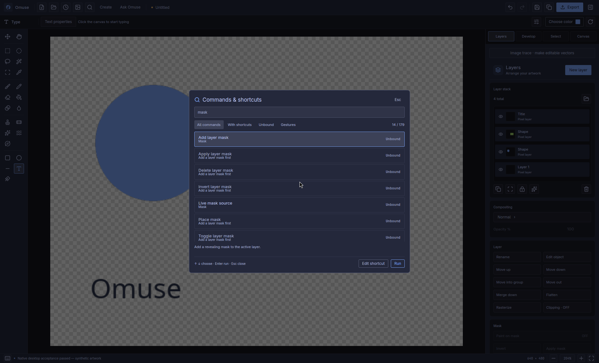

# Omuse

### A native creative studio for photos, vectors and content.

<p align="center">
  
</p>

[](https://github.com/Sugata-Software/Omuse/actions/workflows/rust-validation.yml)

**Built for Omarchy and Arch Linux, with an experimental Windows build.**
The Linux installer builds the tested source release and adds **Omuse** to your
application launcher. Windows has a setup wizard and a portable x64 ZIP;
reviewed Linux bundles are also available. Windows remains unsigned experimental.

**[Install on Linux](#linux)** · **[Download for Windows](#windows-experimental)**

**0.12.0: [Precision, kept editable](https://github.com/Sugata-Software/Omuse/releases/tag/v0.12.0)**
— retained Native16 photo development, portable colour looks, clearer save/removal
review and direct vector controls, with experimental guided local masks.
[Explore what’s new](#new-in-0120) ·
[Follow the illustrated guide](docs/user-guide/editor-quality.md) ·
[Browse the product overview](docs/project-guide.md).

> **Tested source, reviewed packages.** Exact public runtime
> [`9c684cae4a4ccdb763d036b65adc440cc61419c2`](https://github.com/Sugata-Software/Omuse/commit/9c684cae4a4ccdb763d036b65adc440cc61419c2)
> passed [Linux and Windows validation](https://github.com/Sugata-Software/Omuse/actions/runs/40161067985):
> 1,881 Linux and 1,838 Windows application cases, zero failures and eight ignored
> on each platform. Package, native desktop, installation and public download
> checks have separate receipts in the [0.12 release record](docs/release-0120-qualification.md).
> Linux remains a pre-release; Windows is unsigned experimental.

**[Read the user manual](docs/user-guide/README.md)** ·
[Edit a photo](docs/user-guide/photo-editing.md) ·
[Draw and trace vectors](docs/user-guide/photo-vector.md) ·
[Create social content](docs/user-guide/create-content.md)

<p align="center">
  <a href="https://github.com/Sugata-Software/Omuse/raw/refs/heads/main/docs/media/omuse-0.7.0-studio-film.mp4">
    
  </a>
</p>

<p align="center">
  <a href="https://github.com/Sugata-Software/Omuse/raw/refs/heads/main/docs/media/omuse-0.7.0-studio-film.mp4"><strong>&#9654; Watch the two-minute Omuse 0.7.0 film</strong></a>
  &middot;
  <a href="docs/media/omuse-0.7.0-studio-film.md">Chapters, transcript &amp; credits</a>
</p>

This historical **0.7.0** film shows four real photo before/after edits, vector and tracing controls,
branded pages, native motion and content exports. The film combines actual
application captures and Omuse-rendered artwork with editorial animation.
Its AI segment is an offline interface tour.

Omuse is a native image editor built in Rust with GPUI and designed
to feel at home on Omarchy. It combines a compact studio interface with layered
editing, painting, selections, live adjustments, editable text and shapes,
Camera RAW support, colour-managed export, and advanced non-destructive
workflows. The Create workspace adds editable branded pages, templates,
carousels, content packs and motion, with an optional in-app AI assistant.

On Omarchy, the application follows the current desktop theme through
[`gpui-omarchy`](https://github.com/huacnlee/gpui-omarchy), while keeping artwork
colours and the transparency checkerboard independent of desktop styling.
The Windows development build follows the system light or dark app setting.
Editing and local subject selection run on your machine. Optional AI requests
send the selected context to the connection you choose; the assistant identifies
the subscription route and its usage. Separate API billing is currently disabled.
Omuse does not change the desktop theme.



*Actual packaged Omuse 0.10.0 on Linux/Omarchy, source `920ae0fd`.
The composition retains editable curves, independent repeat copies and live
text. [Capture provenance](docs/releases/images/v0.10.0/README.md).*

## Install

### Linux

On **Omarchy or Arch Linux (x86_64)**, open a terminal and run:

```sh
curl -fsSL https://raw.githubusercontent.com/Sugata-Software/Omuse/main/install.sh | bash
```

Then open **Omuse** from your application launcher.

The installer sets up dependencies, builds Omuse, verifies the editor and
installs it for your user. Camera RAW and automatic local subject-selection
assets are included. The experimental Guided subject mask model is a separate,
explicit download; it is not bundled. The installer asks for your password only
if system packages need installing.
Run the command as your normal desktop user; do not prefix it with `sudo`.
The installer selects a pinned [tested source revision](docs/install.md#tested-source-channel),
rather than automatically building every application change on `main`.
The published installer selects the qualified **0.12.0** runtime. The normal
Omarchy installation passed payload, prior-generation and profile-preservation
checks; see the [release record](docs/release-0120-qualification.md).

The installer script itself is downloaded from `main`.

**The current installer builds from source.** Allow time for the first build
and about 12 GB of free disk space. Later installs reuse the build cache.
For an already-built application, use the
[reviewed Linux archive](https://github.com/Sugata-Software/Omuse/releases/download/v0.12.0/omuse-0.12.0-linux-x86_64.tar.gz)
and [checksums](https://github.com/Sugata-Software/Omuse/releases/download/v0.12.0/omuse-0.12.0-SHA256SUMS)
with the [archive installation guide](docs/downloadable-releases.md).
The **38.9 MB** archive and its published checksums are verified against the
reviewed build. Camera RAW, subject selection and dependency notices stay together.
The curl command uses the source-build path; you can
[inspect it](install.sh) before running it.

| Task | Command |
| --- | --- |
| Update | Run the same install command again |
| Launch in a terminal | `~/.local/bin/omuse` |
| Roll back an update | `~/.local/bin/omuse-manage rollback` |
| Uninstall | `~/.local/bin/omuse-manage uninstall` |

Updates keep the previous executable **and its runtime assets** together.
Uninstall keeps your projects, settings and recovery files. The installer does
not change your Omarchy theme or shell configuration. See the
[installation guide](docs/install.md) for custom locations, cached downloads
and troubleshooting.

### Windows (experimental)

**[Download the Windows installer](https://github.com/Sugata-Software/Omuse/releases/download/v0.12.0/omuse-0.12.0-windows-x86_64-setup.exe)** ·
[Installer checksums](https://github.com/Sugata-Software/Omuse/releases/download/v0.12.0/omuse-0.12.0-windows-x86_64-setup.exe.sha256) ·
[Setup guide](docs/windows-installer.md)

For **Windows 10/11 on Intel/AMD x64**. No Rust or Visual Studio required.

1. Download and run **omuse-0.12.0-windows-x86_64-setup.exe** (**20.1 MB**).
2. Follow the setup wizard; add a desktop shortcut if you want one.
3. Open **Omuse** from the Start menu.

Setup installs for your account without requesting administrator rights. To
update, save your work, close Omuse and run the newer installer. Uninstall through
Windows **Settings → Apps**; projects, settings and recovery files are preserved.
The [0.12 setup workflow](https://github.com/Sugata-Software/Omuse/actions/runs/40163791906)
passed all 14 native lifecycle checks, including fresh install, an actual
0.11 → 0.12 upgrade, repair, downgrade refusal and uninstall with project/settings
preservation. [Published installer verification](docs/windows-installer.md#build-and-verification)
records its exact payload, checksums and anonymous download readback.

Prefer portable? [Download the complete ZIP](https://github.com/Sugata-Software/Omuse/releases/download/v0.12.0/omuse-0.12.0-windows-x86_64.zip)
([ZIP checksums](https://github.com/Sugata-Software/Omuse/releases/download/v0.12.0/omuse-0.12.0-SHA256SUMS)),
extract it into a new folder and run **omuse.exe** with **lib**, **models** and
**licenses** beside it. Keep the previous complete folder when updating.
The installer wraps the same reviewed portable application. Both downloads and
their checksums passed exact public readback.

Photo editing and Camera RAW are included. These features have extra requirements:

| Feature | Setup |
| --- | --- |
| Automatic local subject selection | Install Microsoft's [Visual C++ Redistributable (x64)](https://aka.ms/vs/17/release/vc_redist.x64.exe) |
| Guided subject mask · experimental | Explicit optional model download of about 40 MB and an available ONNX Runtime; review/refine results manually. [Guide](docs/user-guide/editor-quality.md#guide-an-optional-local-subject-mask) |
| MP4 / GIF export | Install FFmpeg, for example `winget install Gyan.FFmpeg`, and make sure `ffmpeg.exe` and `ffprobe.exe` are on `PATH` |
| Ask Omuse | Install the official Codex CLI or the native Claude Code CLI, then open **Ask Omuse → Connections** to connect your account |

The Windows installer and ZIP are **experimental and unsigned**, so SmartScreen may show a
warning. Live Windows AI generation/editing and clean-machine acceptance remain
unqualified; detecting a signed-in CLI does not establish that an AI task works.
Both 0.12.0 packages include their reviewed dependency notices. Optional
EfficientSAM-Ti weights remain a separate explicit download.

See the [Windows build notes](rust/README.md#build-on-windows-in-development) for
connection requirements and known limits.

## Highlights

### New in 0.12.0

Develop photos and refine artwork while retaining the source, editable controls
and a clear review-before-Keep workflow. These features share the native canvas,
layers, Omarchy theme and Undo history. The guides explain the controls and
limits, including experimental image-quality routes.

| Workflow | What changes |
| --- | --- |
| **Develop retained photo precision** | Native16 Camera Raw operates on retained developed-RGB words with supported basic, curve, colour, detail, optics and geometry stages. Guarded background previews, native sampling and conservative admission preserve the source. Not sensor-linear RAW, HDR, Adobe rendering parity or calibrated profiles. [Native photo guide](docs/user-guide/editor-quality.md#develop-a-retained-photo-without-reducing-its-word-precision). |
| **Keep a portable colour look** | Import bounded 1D, 3D or declared shaper-plus-3D `.cube` tables, set Amount 0–200% and retain the validated values inside `.omuse`. Encoded-sRGB lookup/output clipping is explicit; this is a creative look, not a display/camera profile. [Colour looks](docs/user-guide/editor-quality.md#import-an-embedded-colour-look). |
| **Review preset intent** | Import a bounded XMP subset into native Camera Raw, inspect supported approximations and unsupported fields, then use the normal Preview/Apply transaction. The accepted mapping report stays with the recipe; proprietary profiles and local adjustments are not imported. [XMP review](docs/user-guide/editor-quality.md#review-an-xmp-preset-as-editing-intent). |
| **Inspect a repair at actual pixels** | Controlled removal offers paired Fit/100% layer views with pinned arrows, Center and Refresh. Source/result images scroll on smaller windows; changed settings cannot be kept as an old review. Inspect seams and donor texture before Apply. [Removal review](docs/user-guide/editor-quality.md#inspect-object-removal-at-actual-pixels). |
| **Know what a save confirmed** | If publication completes but final storage/identity verification is unconfirmed, keep recovery, dirty state and pending-close protection. Retry or save a separate copy; unknown saved identity never authorizes blind overwrite. Linux replacement preserves bounded visible access policy. [Saving](docs/user-guide/editor-quality.md#saving-when-storage-needs-attention). |
| **Work directly on vectors** | Move gradient geometry/stops on canvas, isolate groups, repeat transforms and editable copies, and create configurable stars/polygons. Edit clipping masks or their contents; Escape cancels an active gesture while retaining earlier edits. [Direct vector controls](docs/user-guide/vector-controls.md). |
| **Refine gradient appearance** | Keep Classic, or opt into perceptual OKLab interpolation and deterministic fill Dither. Original stops remain editable. SVG/PDF conversion reports distinguish expanded stops and rasterized dithered objects. [Gradient quality](docs/user-guide/editor-quality.md#finish-gradients-and-simplify-paths). |
| **Guide a local mask · experimental** | Mark a subject or draw one box, compare up to three options and refine coverage with Brush add/remove. Keep an editable mask or use it as a selection. The optional local CPU model downloads only on request; it can select the wrong part or leave holes. Review every result. [Guided masks](docs/user-guide/editor-quality.md#guide-an-optional-local-subject-mask). |
| **Finish paths without losing the original** | Simplify from retained original paths with corner preservation, original overlay and Reset. Enable optional tangent/perpendicular contacts for supported straight Pen segments; ordinary anchors keep priority. [Path finishing](docs/user-guide/editor-quality.md#finish-gradients-and-simplify-paths) · [Pen contacts](docs/user-guide/editor-quality.md#build-precise-contacts-with-the-pen). |
| **Compare fonts and resolve shortcut ownership** | Compare up to three installed fonts on actual text with Unicode/fallback information, then Keep or Cancel. Shortcut recording identifies an existing owner before an atomic draft reassignment. [Fonts and shortcuts](docs/user-guide/editor-quality.md#compare-fonts-and-resolve-shortcut-conflicts). |
| **Understand exchange conversions** | Review structured SVG/PDF compatibility reports and retain supported import notes and inert SVG leaf-object metadata. Unsupported scripts/resources remain refused. Reports do not promise full Illustrator/Photoshop interchange. [Vector reports](docs/user-guide/vector-controls.md#check-a-compatibility-report) · [Metadata limits](docs/user-guide/editor-quality.md#svg-metadata-scope). |

**Keep a separate editable master.** New retained clips require document 16,
embedded looks 17, extended gradient/SVG metadata 18 and Native16 recipes 19.
Older readers cannot open unsupported feature versions; rolling back the
application does not downgrade projects. Ordinary retained 16-bit sources alone
still use format 10. [Saving and compatibility](#projects-and-user-data).

Guided local masks remain experimental, with positive/box prompts only, at most
six point tokens (a box uses two), manual coverage correction and uncalibrated
model rankings. EfficientSAM-Ti weights are not bundled. Controlled removal also
needs useful donor context and can refuse difficult targets. Neither workflow
promises universal reconstruction or matting quality. See the
[illustrated editor-quality guide](docs/user-guide/editor-quality.md) and
[full user manual](docs/user-guide/README.md).

<a id="new-in-0110"></a>

### Earlier in 0.11.0 — historical examples

> The following 0.11.0 captures, connected-AI demonstration and release results
> retain their original scope. They are not 0.12.0 validation or a new provider guarantee.


Keep the next action close to your artwork, keep spacing consistent as content
changes, and compare proposals before committing them. These controls share the
existing canvas, Omarchy theme and Undo history.

| Workflow | What changes |
| --- | --- |
| **Act from the canvas** | Select Move and a layer to reach relevant photo, text, vector or selection actions from a compact dock. Hide it when you want space; restore it with **Ctrl+K → Canvas actions**. [Canvas actions](docs/user-guide/canvas-workflows.md#reach-the-right-action-from-the-canvas). |
| **Keep an editable arrangement** | Retain horizontal or vertical flow, gap, padding, alignment and sizing in a layout frame. Supported content edits reflow with the same Undo step. Release rules to keep the arrangement and resume ordinary positioning. [Auto layout](docs/user-guide/canvas-workflows.md#keep-spacing-consistent-with-an-auto-layout-frame). |
| **Compare AI variations** | Review Before / After, enlarge either preview or highlight Changes. Pin one retained variation to compare another, then return to the original. Comparison makes no provider request. [AI review](docs/user-guide/canvas-workflows.md#compare-an-ai-proposal-before-keeping-it). |
| **Keep your prompt and your space** | Completed reviews use a compact composer footer. Refine or reopen your saved draft and references when ready; active work retains progress and Stop. Rectangular previews keep their proportions. |
| **Continue with the keyboard** | Context actions restore canvas focus before handing control to an editor or dialog. Ungroup and Hide leave ordinary Undo available; collapsed AI drafts cannot submit through Ctrl+Enter. |



**Real connected AI, inside Omuse.** The installed 0.11.0 app used an existing
ChatGPT subscription through Codex to generate this photograph, then remove the
selected orange sphere. Both requests were reviewed and kept through Ask Omuse.

| Generated photograph | After Remove object |
| --- | --- |
|  |  |

Every pixel outside the selection remained exact. Undo restored the original
project; Redo and reopening preserved the edited project. Connections recorded
both image capabilities as **Tested**. These are actual 1024 × 768 canvas
exports from the two-request Linux demonstration on 11 October 2026.
[Try the workflow](docs/user-guide/canvas-workflows.md#try-it-generate-a-product-image-then-remove-an-object) ·
[Prompts, screenshots and verification](docs/ai-live-0110-qualification.md).

**Keep a separate master when trying retained layout.** Layout rules require
native project format 15, which Omuse 0.10.0 and older refuse. Release rules in
the newer editor and Save As a separate copy for older editing; other features
retain their own compatibility limits. An application rollback does not
downgrade artwork. Layout supports direct unrotated leaf layers, not nested
frames; Fill scales editable text instead of rewrapping it.

The [0.11 release record](docs/release-0110-qualification.md) records 1,599 Linux
and 1,581 Windows reported application passes, reviewed archives and 24 native
checks on each Linux backend. Foreground XWayland interaction
covered layout and AI review; actual-package rollback and format-15 compatibility
also passed. The normal Omarchy host installation is verified at 0.11.0;
Linux and Windows workflows, source publication and all four permanent asset
downloads are verified. Five optional external RAW/PSD cases returned early
without configured fixtures, separately from five ignored benchmarks. These
release checks are separate from the live Codex demonstration above and do not
establish a performance guarantee; the earlier
[development checkpoint](docs/canvas-workflows-qualification.md) keeps its own
source identity.

### New in 0.10.0

Build shapes, finish photos and exchange artwork in the same studio.
The [release qualification](docs/release-0100-qualification.md) records the
tested source, Linux/Windows checks, reviewed packages and remaining limits.

| Workflow | What changes |
| --- | --- |
| **Build by dragging** | Merge Shape Builder regions or Alt-drag to erase them. Start with 2–8 consecutive opaque filled paths, then inspect and keep one editable result. [Shape Builder](docs/user-guide/photo-vector-development.md#drag-through-shape-builder-regions). |
| **Refine curves** | Combine Bézier shapes, reduce unnecessary nodes, offset contours and turn strokes into filled outlines. Split or join paths within an object. [Path finishing](docs/user-guide/photo-vector-development.md#build-and-refine-shapes). |
| **Place details precisely** | Snap nodes and handles to nearby anchors, visible guides or grid lines within six screen pixels. Arrange motifs in grids or radial patterns as independent editable copies. [Snapping and repeats](docs/user-guide/photo-vector-development.md). |
| **Exchange Photoshop files** | Export converted 8-bit pixel layers; open supported 16-bit RGB PSD/PSB composites with retained precision. Conversion reports explain what was rendered or omitted. Keep `.omuse` as the master. [Photoshop exchange](docs/psd-exchange.md). |
| **Keep photo controls responsive** | Blur, Smudge and Liquify compute in a cancellable background job. Eligible Camera Raw colour edits show a quick draft before full refinement; Apply still uses original full-size pixels. [Photo workflow](docs/user-guide/photo-editing.md). |
| **Compare removal methods** | Try **Texture · experimental** alongside the default Context method. Review seams and repeated detail before keeping a repair; neither is a universal reconstruction tool. [Removal workflow](docs/user-guide/photo-editing.md#compare-context-and-texture-removal). |
| **Refine a collection** | Design & layout can target existing text on another page using bounded page context. Review, Keep and Undo remain explicit. [Page revisions](docs/user-guide/create-content.md#revise-one-page-and-finish-the-pack). |

[Open the illustrated guide](docs/user-guide/photo-vector-development.md).
The [local qualification record](docs/photo-vector-qualification.md) records
1,554 reported Linux test passes and bounded native editing/export checks for
pre-version-bump development snapshot. Final release checks are recorded
separately; these results are not a general performance comparison or fresh
live-provider acceptance.

### New in 0.9.0

These workflows share the usual canvas and inspector.
[Qualification and limits](docs/release-090-qualification.md) distinguish tested
editing paths from broader hardware and photographic-quality work.

| Workflow | What you can do |
| --- | --- |
| **Retouch source detail** | Blur, Smudge and Liquify preserve source dimensions on scaled or rotated photos. Set Blur radius independently of brush size. [Retouch guide](docs/user-guide/retouch-and-controls.md#control-blur-strength-separately-from-brush-size). |
| **Guide object removal** | Choose clean nearby texture, preview the repair and retain an editable recipe. Inspect seams before keeping it. [Controlled removal](docs/user-guide/retouch-and-controls.md#remove-an-object-using-surrounding-texture). |
| **Align consistently** | Configure grid spacing and subdivisions for both drawing and snapping. [Grid controls](docs/user-guide/retouch-and-controls.md#align-artwork-with-a-configurable-grid). |
| **Inspect a mask** | Alt-click MASK for a grayscale view; return to the artwork before painting. [Mask inspection](docs/user-guide/retouch-and-controls.md#inspect-a-mask-before-refining-it). |
| **Style selected letters** | Search installed fonts, preview a choice and press Escape to restore the original. [Live font preview](docs/user-guide/retouch-and-controls.md#preview-a-font-on-selected-letters). |
| **Keep control of edits** | Typed values survive focus changes, compact text actions stay visible, and ordinary folders ungroup safely in one Undo. [Folder ungroup](docs/user-guide/retouch-and-controls.md#release-an-ordinary-folder-without-flattening-its-children). |

Native retouch accepts 8-bit raster layers or existing masks up to 16 MP;
controlled removal has a separate 4-million-pixel limit and needs useful donor
texture. Neither guarantees a natural repair for every image. New removal
recipes also have an [older-editor compatibility precaution](docs/user-guide/retouch-and-controls.md#keep-new-removal-recipes-safe-when-trying-an-older-version).

### Photo and vector tools from 0.8.0

These additions share the existing photo canvas and Layers inspector.
[Qualification and limits](docs/release-080-qualification.md) distinguish local
editing checks, automated Windows/package checks and remaining hardware work.

| Workflow | What 0.8.0 adds |
| --- | --- |
| **Build vector artwork on the photo canvas** | Select several objects, group them, align, distribute and transform them together. Unite, Subtract, Intersect, Exclude and Divide construct new filled shapes with Undo. [Arrange and combine](docs/user-guide/photo-vector.md#select-group-and-arrange). |
| **Refine fills and strokes** | Editable linear/radial gradients with 2–16 colour and transparency stops; cap, join, dash, gap and offset controls. Apply styles to selected objects in the Layers inspector. [Gradient and stroke guide](docs/user-guide/photo-vector.md#set-gradient-fills-and-precise-strokes). |
| **Put editable text on a curve** | Set content, font, size, tracking and alignment, then update the text from an edited guide. Keep the text recipe in `.omuse`, or convert glyphs to points for further editing. [Text on a curve](docs/user-guide/photo-vector.md#put-editable-text-on-a-curve). |
| **Exchange vector artwork** | Multiple supported SVG objects retain gradients and stroke settings. Export the active vector artwork as PDF, preserving supported paths, transparency and Pad gradients; text exports as glyph outlines. [SVG](docs/user-guide/photo-vector.md#exchange-an-svg-artwork) · [PDF](docs/user-guide/photo-vector.md#export-vector-artwork-as-pdf). |
| **Select colour with softer masks** | Sample a hue, control tolerance, softness and minimum saturation, then replace, add, subtract or intersect a selection, or create an editable layer mask. Feathered coverage stays soft. [Hue and mask guide](docs/user-guide/photo-vector.md#keep-soft-masks-and-select-by-hue). |
| **Borrow a reference palette** | Match reference colour adds a reversible Filter stack effect with Amount, Preserve lightness and optional selection masking. It supports ordinary photos and retained 16-bit sources. [Reference matching](docs/user-guide/photo-vector.md#match-the-palette-of-a-reference-image). |
| **Inspect the JPEG you will export** | Fit and 100% views show the actual encoded file. Pan through detail and compare quality, DPI and matte settings before saving. [JPEG preview](docs/user-guide/photo-vector.md#inspect-jpeg-detail-and-refine-raster-strokes). |
| **Retouch with more consistent strokes** | Blur, Smudge and Liquify use fractional brush footprints and consistent spacing. Smudge carries evolving paint; Liquify samples the original stroke source, with Undo and no partial commit when work limits are reached. [Raster retouch](docs/user-guide/photo-vector.md#inspect-jpeg-detail-and-refine-raster-strokes). |

The published 0.8/0.9 editable SVG subset excludes text import, clipping,
masks, effects, group opacity and gradient strokes. Omuse 0.10 adds
supported text and stroke conversion, with explicit warnings; see
[the expanded subset](docs/user-guide/photo-vector-development.md#exchange-svg-artwork). Vector PDF exports the
active artwork, not the surrounding photo composition; it does not add PDF/AI
import or print-ready CMYK. Complete Create/page PDFs use the existing raster
export workflow. Reference matching transfers a global palette, rather than
recognizing subjects or reproducing an HDR look. The linked guides describe
format, font, image-size and editing limits.

### Studio essentials

- Layers, groups, masks, clipping, blend modes, live adjustments and effects.
- Interactive crop ratios including 3:4, anchored zoom and editable layer/group Copy/Paste.
- Brush, Pencil, Eraser, Fill, Gradient, Clone, Heal and selection tools.
- Editable text with live artwork previews and selected-letter colour styling;
  shapes, Bézier paths, vector masks and transform workflows.
- Integrated vector artwork on the main canvas with Pen, Nodes and Move tools,
  multi-object scenes, editable styles and native `.omuse` project storage.
- Local Image Trace for logos, illustrations and photo-art approximations, with
  Source/Trace preview, retained originals, editable curves and saved settings.
- Target colour uniformity and scale-aware 16-bit export sampling, with explicit
  limits documented in the photo/vector guide.
- Dither, halftone and ASCII, Bloom into transparency, Vignette overlay and
  spatial Local Contrast, with preview and Undo on 8-bit raster copies up to 16 MP.
- Brush, fill and gradient mask growth with preserved placement and outside coverage.
- Editable `.omuse` projects for single canvases and multi-page collections.
- Brand kits, 20 editable templates with 80 tested size variants, rich text, reusable components, image
  frames, CSV variants and a searchable local asset library.
- Social previews, ordered raster/PDF content packs, captions and image descriptions.
- Layer and page animation, MP4/GIF export, audio, editable subtitles and clip tools.
- [Ask Omuse](docs/ai-experience.md): task-based subscription AI for editable designs,
  reversible photo adjustments, captions and image drafts, with Before/After
  review and Undo; provider availability is qualified separately.
- Choose Auto or a provider per task; optionally follow an image edit with
  editable layout and a caption in one reviewed workflow.
- PNG, JPEG, WebP and TIFF export, including retained 16-bit workflows.
- Layered 8-bit RGB PSD/PSB import with supported editable text; Omuse 0.10
  adds 16-bit merged-composite import and converted layered export.
  [Photoshop exchange and limits](docs/psd-exchange.md).
- SVG/SVGZ raster import with selectable dimensions, up to 25 MP;
  self-contained artwork becomes one pixel layer, with the original preserved.
- Camera RAW development and local subject selection; supported byte-compatible or
  retained Native16 photo development, with explicit precision and work limits.
  [Photo development guide](docs/user-guide/editor-quality.md).
- Omarchy-aware controls, colours, theme watching and native Linux file dialogs.
- Refined editing, Create and AI panels with grouped controls and compact layouts.
- Searchable recent projects, draggable numeric values and layer actions that
  explain missing prerequisites.
- Searchable, executable commands and customizable Photoshop-inspired shortcuts.

Explore the [editing workflows](docs/rust-advanced-workflows.md),
[Create guide](docs/omuse-create-guide.md) and
[categorized project guide](docs/project-guide.md). The
[release checklist](docs/public-release-readiness.md) distinguishes tested
features from the remaining public-release work. Omuse focuses on creating
content; calendars and scheduling are outside its scope.

## See the workflows

| Draw and refine on the canvas | Turn an image into editable shapes |
| --- | --- |
| [](docs/user-guide/photo-vector.md#draw-and-refine-an-editable-path) | [](docs/user-guide/photo-vector.md#turn-an-image-into-editable-vector-artwork) |
| **Pen, Nodes and Move** — shape curves, add points, style objects and keep the photo beneath them. | **Local Image Trace** — choose a preset, adjust detail, compare with the source and keep editable artwork. |

| Make a branded collection | Find a command from the keyboard |
| --- | --- |
| [](docs/user-guide/create-content.md) | [](docs/keyboard-shortcuts.md) |
| **Create** — templates, pages, reusable brand elements and ordered export packs. | **Ctrl+K** — search actions, tools and shortcuts, then run the result. |

Start with the [illustrated user manual](docs/user-guide/README.md), follow
[object removal](docs/user-guide/remove-objects.md), or open the
[complete ten-view gallery](docs/releases/v0.7.0-gallery.md).

## Work from the keyboard

Press **Ctrl+K** or click the search icon to find and run commands. Search by
action, tool, category or key combination;
use **↑ / ↓** and **Enter**
to run, or **Esc** to return to your canvas. Commands without a shortcut are
available here too.

Default shortcuts include familiar tools, **Ctrl+L** for
Levels, **Ctrl+M** for Curves, **Ctrl+U** for Hue/Saturation, and **[ / ]** for
brush size. **Ctrl+Alt+K** opens the recorder for customizing, clearing and
restoring bindings. Super stays available to Omarchy.

See the [complete keyboard and gesture reference](docs/keyboard-shortcuts.md)
for all commands, text-editing behaviour and changes from earlier defaults.

## Build and contribute

For developers:

```sh
git clone https://github.com/Sugata-Software/Omuse.git
cd Omuse
scripts/build-rust.sh
rust/target/release/omuse
```

The [development guide](rust/README.md) covers Linux build prerequisites,
tests and the source map. Windows users can [download the installer or portable build](#windows-experimental)
or compile it from source; see
[Build on Windows](rust/README.md#build-on-windows-in-development) for its
current limits. Start with [CONTRIBUTING.md](CONTRIBUTING.md) for a
fix or contribution. Omuse uses Rust with native platform integrations.

## Projects and user data

Use **`.omuse`** for every editable project, from a single canvas to a multi-page
Create collection. Projects are directory packages: keep the entire directory
when copying or backing up artwork. Omuse identifies a canvas by its
`manifest.json` and a collection by its `project.json`, preserving editable
layers, native objects and the collection's pages, brands and packaged assets.

Existing `.comp` projects still open. Their first **Save** offers an `.omuse`
copy and leaves the original intact. Opening a project does not rename or
rewrite it; recovery snapshots stay separate from saved artwork.

**Omuse 0.7.0 writes canvas format 11** for vector scenes and format 10
for ordinary canvases. Omuse 0.6.0 cannot read format-11 scenes or projects with
Target Colour Uniformity.

**Omuse 0.8.0 and later** retain those formats for ordinary and flat legacy
artwork, and uses **format 12** for grouped scenes, **13** for gradients or
advanced strokes, and **14** for editable text on curves. **Omuse 0.7.0 cannot
open formats 12–14 or the reference-colour effect.** Use **Save As**
to retain an older copy; rolling back the app does not downgrade project files.

New 0.9 controlled-removal recipes record **ContextualV1**. Omuse 0.8 can show
their cached result, but editing or resaving there can lose the algorithm
choice. Preserve the 0.9 original and rasterize a separate copy before backward
editing. [Compatibility steps](docs/user-guide/retouch-and-controls.md#keep-new-removal-recipes-safe-when-trying-an-older-version).

Omuse **0.10** adds versioned Texture removal and smoother Camera Raw
tone recipes. Older editors can reject projects containing those recipes;
rolling back the app does not convert a project. Keep the editable original
and rasterize a separate copy in the newer build before backward editing.
That earlier byte-compatible Camera Raw Apply produces raster pixels; the new
retained Native16 path has its own recipe semantics. See
[recipe compatibility](docs/user-guide/photo-vector-development.md#keep-a-compatible-original).

Retained layout introduced in **0.11** requires document format 15.
**0.12** adds selective retained-feature requirements:

| Retained content | Minimum document format |
| --- | --- |
| Editable vector clips / scene 5 | 16 |
| Embedded `.cube` colour looks | 17 |
| Perceptual/dithered paints or inert SVG application metadata / scene 6 | 18 |
| Native16 Camera Raw recipe nodes, including disabled/zero-opacity nodes | 19 |

The writer chooses the highest required version across the document. Ordinary
retained 16-bit source images alone keep format 10; older byte-compatible recipes
retain their previous interpretation. Save a separate master before backward
editing. An exported image or converted copy does not replace the editable
master. See the [0.12 guide](docs/user-guide/editor-quality.md) and
[project-format contract](docs/project-format.md).

New collection saves use schema version 2 with nested `.omuse` pages and
components. Version 1 collections still open, but saving upgrades them to
version 2, which Omuse 0.4.0 and earlier cannot read. Use **Save As** to a new
location if you need to retain a version 1 copy for an earlier release. The
[compatibility contract](docs/omuse-rename.md) explains the preserved layer
format and migration behavior.

On Linux, settings and application data use the XDG locations
`$XDG_CONFIG_HOME/omuse` and `$XDG_DATA_HOME/omuse` (normally
`~/.config/omuse` and `~/.local/share/omuse`). On Windows, settings use
`%APPDATA%\omuse`; data and recovery use `%LOCALAPPDATA%\omuse`, unless XDG
locations are explicitly set. The rename keeps compatibility
with earlier settings, shortcuts, brushes and recovery data. See the
[rename compatibility contract](docs/omuse-rename.md) for the migration rules.

## Test and release evidence

Run the local Rust checks with:

```sh
scripts/test-rust.sh
```

The complete test journey includes MP4/GIF export and requires FFmpeg.

Automated headless checks do not replace native display, portal,
mixed-DPI or optional-backend qualification. The required evidence is listed in
[Rust release gates](docs/rust-release-gates.md) and
[save/recovery qualification](docs/rust-release-qualification.md).
The maintained [OmaPhoto comparison](docs/omaphoto-comparison.md) connects
upstream releases to implemented improvements and remaining qualification work.

## History and attribution

Omuse is developed by [Sugata Software](https://github.com/Sugata-Software).
Contributions and carefully scoped bug reports are welcome; start with
[CONTRIBUTING.md](CONTRIBUTING.md). Use copies of important artwork while
evaluating Omuse.

Omuse grew from [Robbie Tilton's Compositor](https://github.com/robbietilton/Compositor)
and [its earlier Linux fork](https://github.com/chiddekel/Compositor). We retain
their original copyright notices and credit their contribution to the project
format and editing foundations. Omuse has its own Rust/GPUI interface,
workflows and release path, with Linux as its reference platform and Windows
support in development.

See [acknowledgements and source provenance](docs/source-provenance.md) for
upstream credits and the archived implementations.

## License

Application source: MIT — see [LICENSE](LICENSE), including the retained
original copyright notice. Third-party code, fonts, images and optional runtime
assets retain their own licences. Runtime notices are under `rust/licenses/`.
The [dependency notice review](docs/rust-license-findings.md) records the
0.8.0 resolved missing-text findings, provenance and remaining platform
checks; this does not change older download receipts or qualify a public binary.
The source licence does not relicense third-party media.
