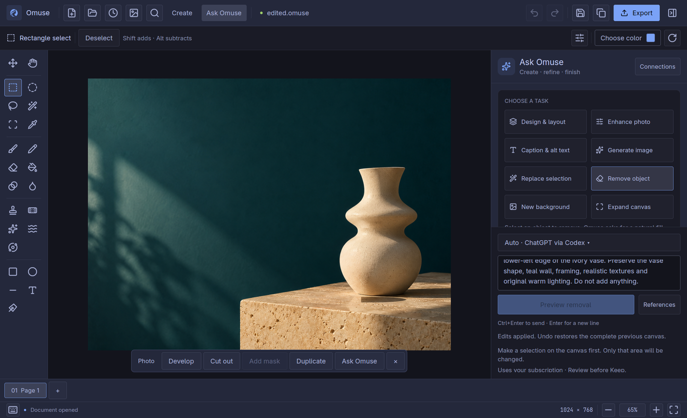

# Omuse 0.11.0: live image generation and object removal

**Live workflow passed — 11 October 2026.** The normal installed Omuse application
generated a product photograph through its connected Codex subscription, removed
the selected orange sphere, then saved, undid, redid and reopened the artwork.
Pixels outside the submitted selection remained byte-exact.

## Application and connection

- Omuse **0.11.0**, public runtime
  [`e72bccdcef066cb6ab60a99faa9d7609de86c2e4`](https://github.com/Sugata-Software/Omuse/commit/e72bccdcef066cb6ab60a99faa9d7609de86c2e4).
- Installed executable SHA-256:
  `8ae84dd9e2f6b940fe4e77d8599a251f0fdbb5788455ed2b289470046ccf1af2`.
- Ordinary Linux/Omarchy interface, operated through Cua; provider
  `codexSubscription`, official subscription runtime **codex-cli 0.158.0**.
- Isolated demonstration profile with the existing subscription login through the
  ordinary app adapter; no test hooks or separately billed API fallback.
- New artwork created for this demonstration. No personal photograph was used.

The published runtime is unchanged. This is additional connected-provider
evidence for the existing release, separate from its earlier local review
fixtures and automated checks.

## Completed generation

In **Ask Omuse**, the Generate task received this brief:

> Photorealistic editorial product photograph, landscape 4:3. An unbranded sculptural ivory ceramic vase and a small matte coral-orange sphere on a warm limestone plinth. Deep petrol-teal studio background, late-afternoon directional light, soft natural shadows, subtle 35mm film grain, premium 1970s design magazine art direction and realistic ceramic texture. Generous negative space in the upper left for later typography. No text, logos or watermark.

The connected provider returned a **1,448 × 1,086 PNG**, **1,998,813 bytes**,
which Omuse placed on the demonstration's **1,024 × 768 canvas**.
Omuse recorded result `AC64D116-4606-4F08-9A5A-BF8C760B1340` in local history,
with generation provenance identifying Codex CLI 0.158.0. The result was
reviewed, kept on the canvas and saved as `generated.omuse` through the normal
application. [View generation in the app](user-guide/images/ai-live-0110/generation-review.png).

## Selected-object removal

The orange sphere was selected in the generated image, then the **Remove object**
task requested removal of the sphere and its cast shadow. The request also
asked for reconstruction of the limestone and the newly exposed vase edge,
preserving the framing, teal wall and lighting. Its exact instruction was:

> Remove only the small orange sphere and its cast shadow inside the selection. Reconstruct the natural limestone surface and the previously hidden lower-left edge of the ivory vase. Preserve the vase shape, teal wall, framing, realistic textures and original warm lighting. Do not add anything.

The returned removal was inspected through **Changes** and the comparison view,
then kept and saved. Local history identifies the removal as
`8AA2640F-88B4-4E1C-8E90-28AA2154BA1E`. These are direct exports of the saved
canvas before and after that edit:

| Generated image | Selected sphere removed |
| --- | --- |
|  |  |

The provider supplied the replacement, while Omuse applied the submitted mask
to preserve the surrounding artwork. The exported 1,024 × 768 canvas had:

| Check | Result |
| --- | --- |
| Selection bounds | x = 603, y = 488; 168 × 158 pixels |
| Editable coverage | 26,544 pixels |
| Changed pixels inside the selection | 26,411 |
| Protected pixels outside the selection | All 759,888 preserved, including every RGBA channel |
| Saved mask and source | Saved masks match the submitted mask; the generated export matches the submitted source canvas |

## Undo, Redo and reopen

The native GUI journey created five saved checkpoints:

| Saved checkpoint | Verified result |
| --- | --- |
| `generated.omuse` | Reviewed generation, kept and saved |
| `edited.omuse` | Reviewed removal, kept and saved |
| `undo.omuse` | Toolbar Undo restored the generation; project bytes and decoded pixels match `generated.omuse` exactly |
| `redo.omuse` | Toolbar Redo restored the edit; project bytes and decoded pixels match `edited.omuse` exactly |
| `reopened.omuse` | Opened the saved edited project and saved again; project bytes and decoded pixels still match `edited.omuse` exactly |

Source layers, image payloads, retained resources and AI provenance were
preserved. The verification read the GUI-saved packages and exported their
active pages through the same installed executable; native captures record the
GUI action sequence. Every recorded check passed, and the executable hash
remained unchanged.

Connections now reports **Image generation — Tested** and
**Image editing — Tested** for the demonstrated connection.
The corresponding operation receipts are retained in the isolated demonstration profile.

## Evidence scope

This records one live generation and one selected-object removal through
ChatGPT via Codex on Linux, including review, Keep, Undo/Redo and saved-project
integrity. It demonstrates this composition and selection; inspect edges and
texture on each new image. Claude and other provider routes were not tested
in this pass.

Private receipts, generated assets and native captures are retained in evidence
set `omuse-0110-live-ai-2026-10-11`. The
[public receipt](user-guide/images/ai-live-0110/receipt.json) records checks and
asset hashes. Public images are unmodified native captures or direct exports
of the saved canvas. See the
[canvas workflow guide](user-guide/canvas-workflows.md) and the
[release qualification](release-0110-qualification.md) for the underlying
editing and application checks.
