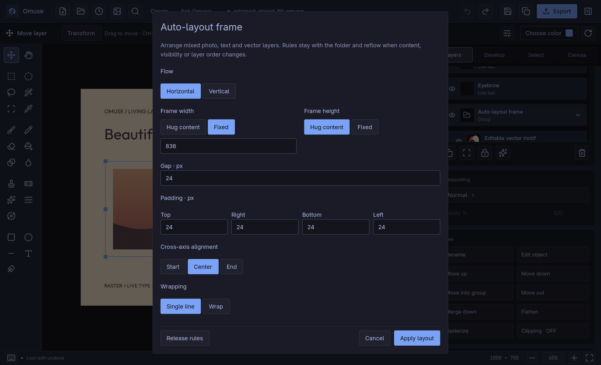

# Canvas actions, layout frames and AI comparisons

[User manual](README.md) · [All shortcuts](../keyboard-shortcuts.md) ·
[Release evidence](../release-0110-qualification.md)

**New in Omuse 0.11.0.** These controls use the same canvas, layers, Omarchy
theme and Undo history as the rest of Omuse. Retained layout requires a newer
project format; keep a separate copy before adding rules to an older project.

## Reach the right action from the canvas

Select **Move — V** and a layer. A compact bar at the bottom of the canvas
offers actions for the selection:

| Selection | Useful actions |
| --- | --- |
| Photo | Develop, Cut out, Add mask, Duplicate, Ask Omuse |
| Selected pixels | Remove object, Fill, Move pixels, Deselect |
| Editable text | Edit text, Transform, Duplicate |
| Editable artwork | Edit artwork, Transform, Duplicate |
| Multiple layers or a folder | Auto layout, Group or Ungroup, Duplicate |
| Vector edit | Select objects, Edit points, Duplicate, More controls |
| Floating pixels | Keep pixels, Cancel |

Actions retain their usual prerequisites. Unlock layers before changing them.
The bar hides while painting, dragging, panning, editing text, cropping or
using a modal. It wraps within narrow canvases and keeps a stable position
when you zoom. It does not introduce new tools or a separate Undo history.

Choose **×** to hide the bar. To restore it, press **Ctrl+K**, search **Canvas
actions**, then press **Enter**. This view preference is saved for your user.
Shortcut tooltips follow your customised bindings.

## Keep spacing consistent with an auto-layout frame

1. Select adjacent photo, text or vector layers from the same folder. Use
   the existing layer multiselection controls; keep the source layers editable.
2. Choose **Auto layout** in the canvas bar, or find it through **Ctrl+K**.
3. Choose **Horizontal** or **Vertical** flow, then set **Gap** and the four
   **Padding** values in canvas pixels.
4. Choose a frame size. **Hug content** grows with its contents; **Fixed**
   keeps the width or height you enter. Choose cross-axis alignment.
5. Choose **Apply layout**. The layers become children of a retained frame.
   **Ctrl+Z** restores the complete operation in one step.

The rules remain in the `.omuse` project. Text edits, layer visibility and
stack order can reflow the frame in the same Undo step as the original edit.
Select the frame and reopen **Auto layout** to change its rules.
Move the whole frame with the Move tool. Change the frame's width and height
in **Auto layout**; its canvas resize handles do not scale retained rules.

To change a member's sizing, select the child layer and use **Ctrl+K → Auto
layout**. **Hug content** uses its source rectangle and intrinsic scale;
**Fixed** uses an explicit dimension; **Fill frame** shares the available
space. Fill requires a fixed frame dimension. Layout scales placement and
preserves editable sources; it does not add automatic text wrapping.
Source rectangles can include transparent padding; sizing is not an optical
measurement of the visible marks.

For wrapping, give horizontal flow a fixed width, or vertical flow a fixed
height, then choose **Wrap**. Wrapping supports Hug and Fixed members. It
cannot be combined with Fill in this version. Fixed frames do not clip
overflow, so inspect oversized children before exporting.

Choose **Release rules** to keep the arranged folder and free its children
from automatic positioning. Ungrouping also removes the frame relationship.
Moving a member out of its frame preserves its placement and releases its
member rule.

Layout owns member positions. Reorder the children or move the whole frame
instead of dragging a member independently. Resize a member individually to
set a fixed dimension, or edit its sizing rule; rotating a member and
transforming several members together require releasing the rules first.

**Canvas Size** and **Crop** preserve the rules and source pixels. Moving the
document origin translates the frame and its masks together. **Create resize**
scales authored sizing and spacing according to the frame's adaptation rule.
Destructive **Image Size** resampling requires **Release rules** first; changing
only the document resolution remains supported.

### Current layout boundaries

Frames accept direct, unrotated photo, live text and vector layers. Nested
frames/folders, adjustment layers and clipping relationships are refused.
Unlock a child or frame before an edit that would reposition or resize it.
Unsupported rules and resource-limit failures leave the document unchanged.

There are limits of 64 frames, 256 children per frame and 2,048 total frame
members. These are resource bounds, not a claim about interactive performance
at those limits.

**Save As a new project when trying retained layout.** Projects containing
layout rules use native format 15. Omuse 0.10.0 and older refuse them. Projects
without layout rules retain their previous format requirements. Exported
images remain ordinary images; `.omuse` is the editable master.

## Compare an AI proposal before keeping it

After an existing AI task completes, review **Before / After** side by side.
Choose an individual image to inspect it in a larger preview, or choose
**Changes** to highlight visible differences. The canvas remains unchanged
until you choose **Keep result**.

The percentage and difference image describe the reduced preview, using a
small visibility threshold against light and dark backgrounds. They are not
a full-resolution pixel audit or a quality score. Different canvas sizes or
active pages cannot produce a meaningful aligned difference; compare them
visually instead. Saved results without their original source preview do not
use today's canvas as a substitute Before image.

For multiple retained variations, choose **Pin this variation for comparison**,
then select another variation. Compare them side by side or through Changes.
Choose **Compare with original** to clear the pin. Comparing previews makes
no provider request and does not use subscription allowance. Generating or
refining still follows the existing connection, consent and provider rules.

Review the listed proposed edits and expand the remaining details if needed.
Keep applies the currently selected result. If you edited or replaced its
source while reviewing, Omuse's existing stale-result checks still prevent
that result from overwriting the newer work.

Completed reviews give previews more room with a compact footer. Choose
**Refine result** to continue from the reviewed proposal, or **Open composer**
to return to your prompt. **Collapse composer · keep draft** keeps your text
and references for later. The prompt stays open while you are typing, and
active requests retain their progress and **Stop** controls. **Ctrl+Enter**
only submits from the focused prompt; a collapsed draft is not sent.

### Try it: generate a product image, then remove an object

This example was made through **ChatGPT via Codex** in the normal Omuse 0.11.0
application. The first live request generated the vase and orange sphere; the
second removed the selected sphere. Both images below are direct exports of
the saved 1,024 × 768 canvas.

| Generate a scene | Remove the selected object |
| --- | --- |
|  |  |

1. Open **Ask Omuse → Connections** and choose your connected **ChatGPT via
   Codex** route. Generation and image editing are separate capabilities;
   each shows **Tested** after its successful live operation.
2. Choose **Generate image** and describe the scene. This demonstration asked for an
   ivory ceramic vase and a coral-orange sphere on limestone, a petrol-teal
   studio background, warm directional light and space for later typography.
3. Review the returned image, choose **Keep result**, then save the `.omuse`
   project. The provider returned 1,448 × 1,086 pixels; Omuse placed that image
   on this example's existing 1,024 × 768 canvas.
4. Select the sphere and the shadow you want to replace. Include the area that
   needs reconstruction, and keep artwork you want unchanged outside the
   selection. Choose **Remove object** in Ask Omuse.
5. Describe the repair. The instruction used here was:

   > Remove only the small orange sphere and its cast shadow inside the selection. Reconstruct the natural limestone surface and the previously hidden lower-left edge of the ivory vase. Preserve the vase shape, teal wall, framing, realistic textures and original warm lighting. Do not add anything.

6. Inspect **Before / After** and **Changes**, especially the repaired edge and
   nearby texture. Choose **Keep result** when satisfied, then save.
7. Use the toolbar's **Undo** and **Redo** to compare the committed edit. Reopen
   the saved project to continue working with its retained layers and source.

In this run, all **759,888 pixels outside the selection stayed byte-exact**.
Undo restored the saved original; Redo and reopening restored the saved edit,
with identical project bytes and decoded pixels. The original image, removal
mask and provider provenance remained in the project. Connections showed both
image capabilities as **Tested** after the two requests.

These are actual 0.11.0 Linux/Omarchy captures and live Codex results. The
[verification record](../ai-live-0110-qualification.md) and
[public receipt](images/ai-live-0110/receipt.json) identify the app, connection,
saved-project checks and image hashes. Review each new removal for convincing
edges and texture; this example qualifies one composition and selection.
