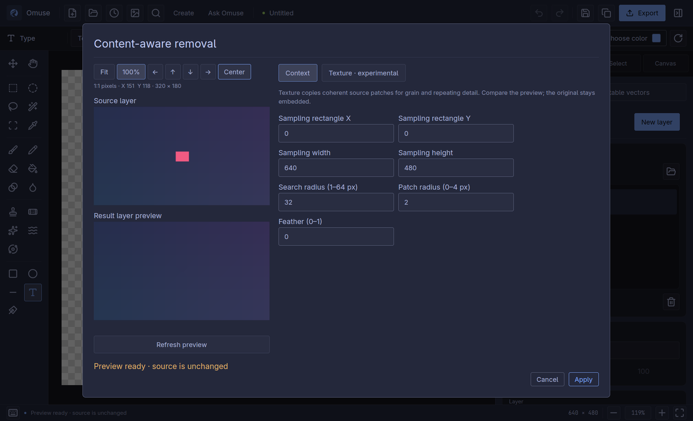
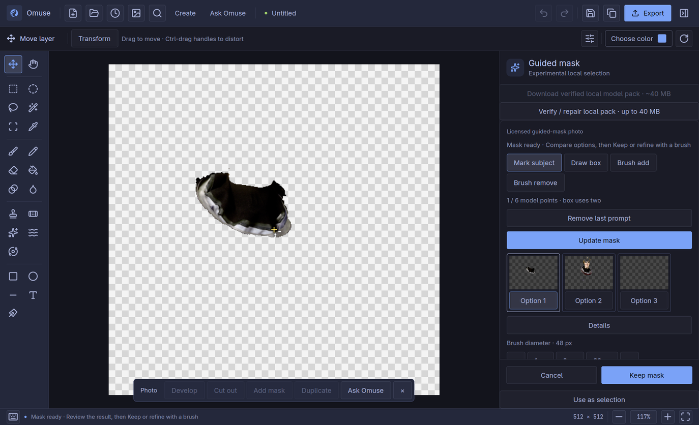

# Editor quality improvements

[User manual](README.md) · [Project compatibility](../project-format.md)

**Omuse 0.12.0.** These controls share the native photo/vector canvas and Undo.
Guided local masks and Texture removal remain experimental; inspect and refine
results before keeping them. See the [release qualification](../release-0120-qualification.md)
for tested scope and remaining platform/photo-quality limits.

## Saving when storage needs attention

Save with **Ctrl+S**, or **Ctrl+Shift+S** for a separate copy. Press **Enter**
in Open, Import, Save and Export path fields to confirm. An existing-project
replacement still needs its separate review; Enter never discards an unsaved-work prompt.

Omuse stages a complete package before publishing it.
If publication succeeds but the final storage flush or saved identity cannot be
confirmed, the editor explains that the project was written, keeps recovery data
and keeps the document unsaved. A pending close waits for your decision.

Use **Save again** when the saved identity remains known, or **Save a copy…** to
choose a different name or folder. When the current saved identity is unknown,
Omuse refuses a blind overwrite; reopen the written project or save a separate
copy. Dismissing the notice does not confirm durability or discard recovery.
An error before publication leaves the prior package in place. Keep recovery
until you have a confirmed save. These protections do not replace backups.

## Inspect object removal at actual pixels

1. Select the unwanted object and open **Controlled content-aware removal**
   through **Ctrl+K**. Choose an allowed source area that excludes the object,
   its shadow and other protected content.
2. Run Preview. **Fit** shows the overall repair; **100%** shows paired
   source/result crops without resampling their image-layer pixels.
3. Fit/100%, pan, Center and Refresh stay pinned above and below the image pane.
   On a smaller window, scroll the paired images while the controls stay reachable.
   Use the arrows to move the detail crop and **Center** to return
   to the repair. Check seams, repeated texture, thin edges and nearby detail.
4. Change settings and refresh when needed. A changed setting invalidates the
   old review; a refresh during work replaces the obsolete request.
5. Apply only after reviewing the current result. The original source remains
   retained; **Ctrl+Z** reverses the kept edit.

*Historical capture from Linux development candidate `e245efa34be1`. The synthetic marked-object
fixture demonstrates the controls and source/result review; it is not a
photographic reconstruction-quality example.*

The detail view inspects the image layer, not the final multilayer composition.
It does not promise that reconstructed background detail is factually correct.
See [object removal](remove-objects.md) for choosing a local or AI method.

## Edit a clipped group without losing its artwork

Select one eligible clipped group. **Edit mask** selects its silhouette for node
editing; **Edit contents** selects the retained artwork inside it. The inspector's
explicit mask row selects that mask alone. Whole-group selection uses conservative
visible bounds; direct content editing keeps the original full geometry.

During a node, object or selection drag, **Escape** cancels that gesture while
preserving earlier edits. Release the pointer before starting another gesture.
Deleting a clipping mask releases the clip while preserving its contents.
Keep the `.omuse` master for editable clipping relationships.

## Import an embedded colour look

Open the editable photo effect stack and choose **Colour look (.cube)**.
Use **Import .cube look…**, set **Amount** from 0–200%, then **Add effect** and
preview. Apply keeps the stack as an editable layer recipe. Reopen the project
or select the look node later to adjust its amount.

Omuse supports bounded 1D, 3D and shaper-plus-3D tables with declared domains.
The look operates in encoded sRGB with clamped lookup coordinates and clipped
output; it is not a camera, display, linear-light or HDR profile. Imported table
values are embedded in `.omuse`, so moving or deleting the source `.cube` file
does not break the saved look. Large recipes can be refused before publication.
Projects containing this new effect require native format 17 or a newer reader.

## Develop a retained photo without reducing its word precision

For a retained RAW/16-bit image layer, **Camera Raw** uses the new native
processing path. Preview leaves the source unchanged; Apply adds an editable
grade with one Undo. Basic adjustments, curves, colour mixing/grading,
calibration, detail, optics and geometry work on retained words. Point-colour
range display is a preview aid and is not baked into the result.

The image is already developed RGB, not sensor-linear RAW. The native path
supports encoded sRGB, linear sRGB and Display P3 storage, with a limit of
16,777,216 pixels and additional memory admission. Its scopes use the display
proxy. This does not establish calibrated camera profiles, HDR, Adobe appearance
or GPU acceleration. New native camera recipes require project format 19.

Older byte-compatible recipes retain their old behavior. Ordinary paint-layer
Camera Raw still uses that compatibility path; it is not silently upgraded.
Keep an original project before using the new retained editing features.

## Review an XMP preset as editing intent

Open **Camera Raw**, then **Import XMP preset…** and choose a local file. Review
which fields can be approximated by native controls and which are unsupported.
**Use supported settings** changes the draft; Preview and Apply follow the normal reversible
workflow. The accepted mapping report stays with the kept recipe.

Ordinary paint layers need **Promote to editable photo** first. This
keeps the source and existing appearance recipe; it does not reinterpret older
byte-compatible grades. Kelvin/As Shot white balance, proprietary camera/lens
profiles, crops and local adjustments are not imported. A supported slider name
does not promise Adobe rendering equivalence. Apply or cancel any pending byte-compatible draft before promotion; a fresh
native review starts from the original pixels. Keep the original XMP/master.

## Guide an optional local subject mask

Find **Guided subject mask** through **Ctrl+K**. The experimental panel uses an
optional, pinned EfficientSAM-Ti CPU model. **Download** is explicit and about
40 MB; opening the panel does not download anything. **Verify / Repair** checks
exact model bytes and provenance; repair retains the previous pack. Processing
is local and does not use an AI subscription or send the photo to a provider.

Mark the subject with a positive click or **Draw box**, then compare the proposed
masks on the canvas. The model accepts at most six point tokens; a box uses two.
Use **Brush add/remove** for local correction, with **[ / ]** to change brush
size. Model negative clicks are not supported. Inspect hair, thin edges, holes
and neighbouring objects at useful zoom before keeping anything.

**Keep mask** adds an editable layer mask with one artwork Undo; **Use as
selection** changes the pixel selection instead. **Cancel / Escape** leaves the
source unchanged. The currently displayed candidate must finish preparation
before it can be kept. This workflow remains experimental and needs careful visual refinement;
a model score is not a guarantee of a good cutout.

*Actual local inference in the same development candidate. NASA / Eileen Collins,
public domain. The point marks the collar, so this option selects that part;
it is not a whole-person cutout. Compare options and refine coverage manually.*

## Finish gradients and simplify paths

In a vector gradient's shared inspector, **Classic** retains existing appearance.
**Perceptual** blends through OKLab; **Dither** adds deterministic fine variation
to reduce visible banding. Original editable stops remain in the `.omuse` master.
New paint semantics require native format 18 / vector scene 6.

SVG/PDF export expands a perceptual colour curve into vector stops. Dithered
objects are converted to bounded pixel artwork, including their stroke, while
other objects remain vector. Read the compatibility report before sharing.
Keep `.omuse` when you need the original controls and stops.

For selected editable paths, use **Simplify** with a tolerance, **Preserve corners**
and **Show original**. Repeated previews start from the retained original rather
than progressively simplifying the preceding preview. Review the anchor count;
**Reset Simplify** restores the original paths. Very dense work has review limits.

## Build precise contacts with the Pen

Enable **Tangent** or **Perpendicular** in the Pen inspector. When extending a
straight segment from the last anchor, nearby eligible curves can show a contact
guide. Ordinary anchors take precedence. **Shift** or **Alt** bypasses contact
snapping. The options are off initially and apply only to supported Pen gestures;
they do not change all object/node movement or create geometric constraints.

## Compare fonts and resolve shortcut conflicts

While editing text, open the installed-font chooser. Use **Compare** to pin up
to three samples of your selected text or headline. Hover or use **↑/↓** to preview
on the canvas. **Use font** keeps a comparison card’s font; **Keep font** keeps
the current choice. **Cancel** or **Escape** restores the prior text style. The cards identify actual fallback fonts where needed. Samples
are limited and may clip; check the real text box and wrapping before keeping.

Open shortcut settings from **Ctrl+K**. Recording a chord already owned by another
command presents that owner and the proposed change. **Reassign** changes the
draft atomically; **Cancel** preserves both bindings. Apply settings to activate
and persist the draft. Reserved chords remain protected. Resetting or changing
bindings invalidates an older reassignment review.

## SVG metadata scope

SVG import can retain a small allowlist of inert leaf-object labels and
application attributes through editing, copying, `.omuse` save and SVG export.
Scripts, event handlers, external resources and arbitrary foreign elements stay
unsupported. Group/root/definition metadata may be dropped with a report. This
is bounded metadata portability, not complete Illustrator or Inkscape round trip.
