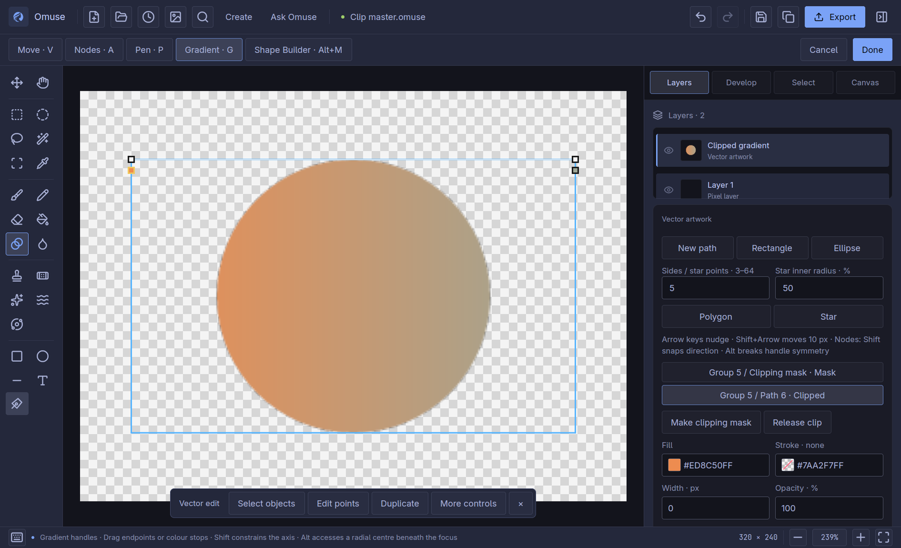
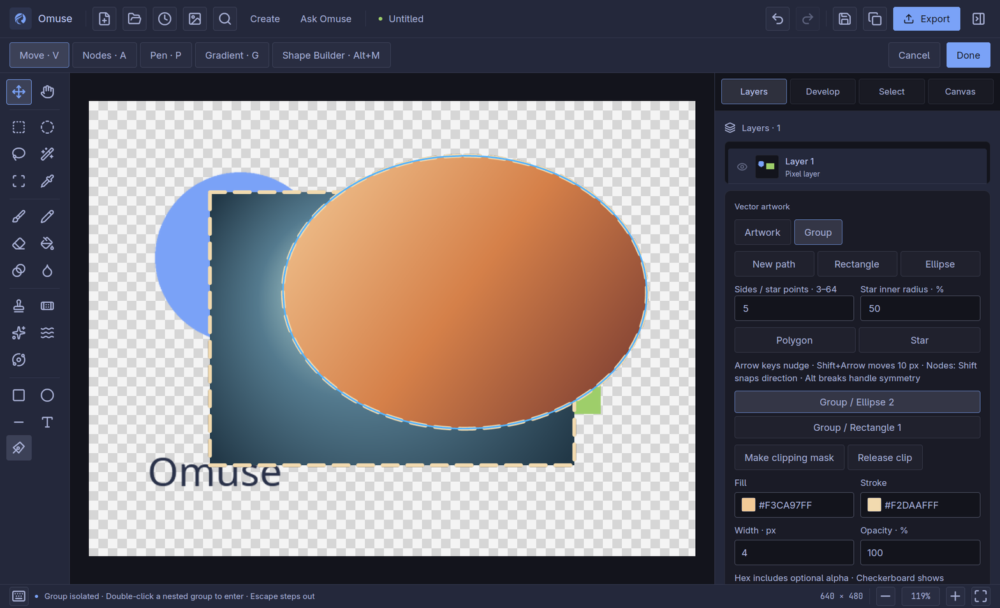
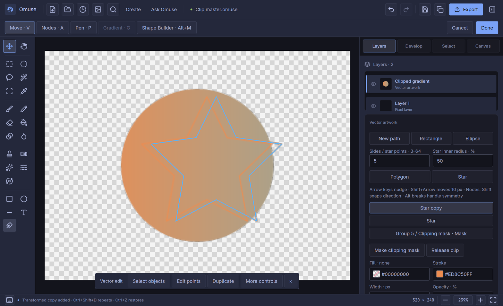
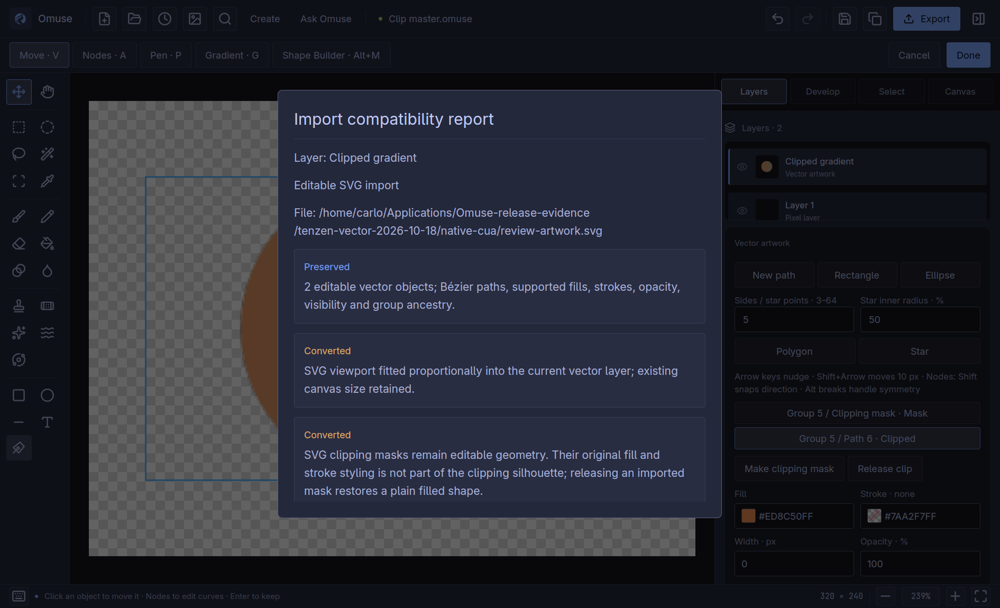

# Direct vector controls

These workflows are included in Omuse 0.12.0. They use the normal
canvas and Layers inspector. Open **Vector artwork** with **Shift+P** and find
any named action with **Ctrl+K**. **Enter / Done** keeps the artwork session as
one document edit. **Ctrl+Z / Ctrl+Shift+Z** step through draft edits.

[User manual](README.md) · [Vector foundations](photo-vector.md) ·
[Shape Builder and geometry](photo-vector-development.md)

## Edit a gradient on the artwork

1. Select one vector object. For grouped artwork, **Ctrl-click** its object
   row or canvas shape to select one member, or double-click to isolate the
   group first. In the inspector choose a **Linear** or **Radial** fill and set
   the colours you want.
2. Press **G**, choose **Gradient handles** in the canvas toolbar, or search
   **Edit gradient on canvas**.
3. Drag the endpoint handles to change a linear gradient's direction and span.
   Hold **Shift** to constrain the axis to 45-degree steps.
4. Drag a colour chip beneath the axis to move its stop. Stops keep their
   colours when they cross. Select a chip and use **Stop colour** in the
   inspector to change its colour or transparency; use **Add stop / Remove**
   there to change the number of stops.
5. For a radial gradient, drag the outer handle for the radius or the focus
   handle to shift the light. Hold **Alt** to reach the centre when the focus
   lies on top of it. The focus stays inside the radius.

A completed drag is one draft Undo step. Gradient coordinates and colours stay
editable in `.omuse`; the handles and their chips are editing guides only.
Use Move, Nodes or Pen to leave gradient manipulation.

Historical native Linux development capture: the gradient remains editable inside a retained clip.

## Work inside a group

Double-click a group on the canvas to isolate it. Surrounding vector artwork
is dimmed and cannot be selected through the isolated group's canvas or object
list. Double-click again to enter a nested group.

Breadcrumb buttons above the inspector return to an ancestor or **Artwork**.
**Escape** steps out one level, retaining edits. Once outside isolation,
Escape retains its usual meaning of discarding the unfinished vector session.
**Ctrl+A**, marquee and matching-style selection stay inside the current
isolation. Added shapes become members of that group.

Isolation changes the editing view; it does not change exported colours or
saved object opacity. **Ungroup** releases the next selected child group and
will not accidentally remove the ancestor you are currently editing inside.

The native interaction fixture shows isolation in the main studio window.

## Transform copies and repeat the last transform

Select objects with **V**. Set **Move X/Y**, **Scale** and **Rotate** in the
inspector. Choose **Transform a copy** to leave the originals in place and
select the new copies. Then use **Repeat copy · Ctrl+Shift+D** to continue the
same operation. **Repeat transform · Ctrl+Shift+T** applies the last transform to the current
selection without creating a copy. A completed canvas move also becomes the
last transform.

Scaling and rotation use each selected set's bounds centre. These are ordinary
editable objects; later source edits do not update the copies. **Ctrl+D** still
clears the vector selection and **Ctrl+J** duplicates it. Undo reverses each
copy/transform separately.

## Make an editable clipping mask

1. Put a closed shape above the objects you want to crop. A compound shape can
   contain holes. The shape's silhouette defines the clipping area.
2. Select the contents and that top shape, then choose **Make clipping mask**
   in the inspector or command search.
3. The object list labels the source **Mask** and its contents **Clipped**.
   Choose **Edit mask**, or select its explicit mask row, then press **A** to
   move its nodes/handles or insert points. **Edit contents** selects the retained
   artwork inside the clip. During an active drag, **Escape** cancels that
   gesture while preserving earlier edits.
4. Choose **Release clip** to restore the source shape and unclipped contents.
   Undo restores the exact relationship and appearance.

The mask's paint is retained for release but does not paint over the contents
while clipping. Convert live text to outlines before making it a mask. Release
clipping before operations that would break its relationships, open a mask or
make another clip around already clipped objects. Nested clipping is not yet
supported.

Projects containing retained clips require **native format 16 / vector scene
5** and a build that understands them. Keep a separate master before editing
with an older Omuse. Releasing a clip does not downgrade an already upgraded
project format. SVG/PDF export carries the clipping appearance; editable
SVG import currently accepts bounded local user-space path silhouettes and
reports conversions. Original mask paint is retained in `.omuse`, while SVG
clipping represents the silhouette rather than that paint.

The mask target exposes its retained anchors and handles directly on the canvas.

The top mask anchor was dragged inward; the clipped gradient follows the edited
silhouette. One Ctrl+Z restored the original circle in the native check.

## Draw a star or polygon, and swap colours

Set the star/polygon point count (3–64) in the inspector and the star's inner
radius (1–99%) as a percentage. Choose **Star** or **Polygon**. Use **V** to place the object
and **A** to reshape its points. Invalid values leave the artwork unchanged.
Creation settings do not remain live parameters after insertion.

Press **X** while vector artwork has canvas focus to swap the selected objects'
solid fill and stroke. A missing stroke is created with a useful width when
needed. Gradient fills are refused rather than converted into an unsupported
gradient stroke. The explicit **Swap vector fill and stroke** command is also
available in command search.

Historical native development capture: X swapped the star to a stroke; Shift+Right moved
it, and Ctrl+Shift+D made the next transformed copy.

## Check a compatibility report

After importing SVG, use **Import report** to inspect **Preserved**,
**Converted**, **Not included** and **Blocked** notes. Accepted import notes
travel with the retained artwork in `.omuse`; Undo removes the import and its
report together. A refused import leaves existing artwork unchanged.

After exporting vector SVG/PDF, open **Export report** for the last destination
and conversion notes. This command exports the active vector artwork, not
surrounding photos or the complete layered composition. Keep `.omuse` for text
recipes, clipping-mask paint and the full project. A successful file write does
not establish fidelity in every receiving editor.

Closing either report returns to the unfinished artwork session. These reports
do not add Illustrator, PDF or EPS editable import support.

The reopened report keeps layer context and clear category cards. The report
scrolls; Escape returns to the same vector draft.
